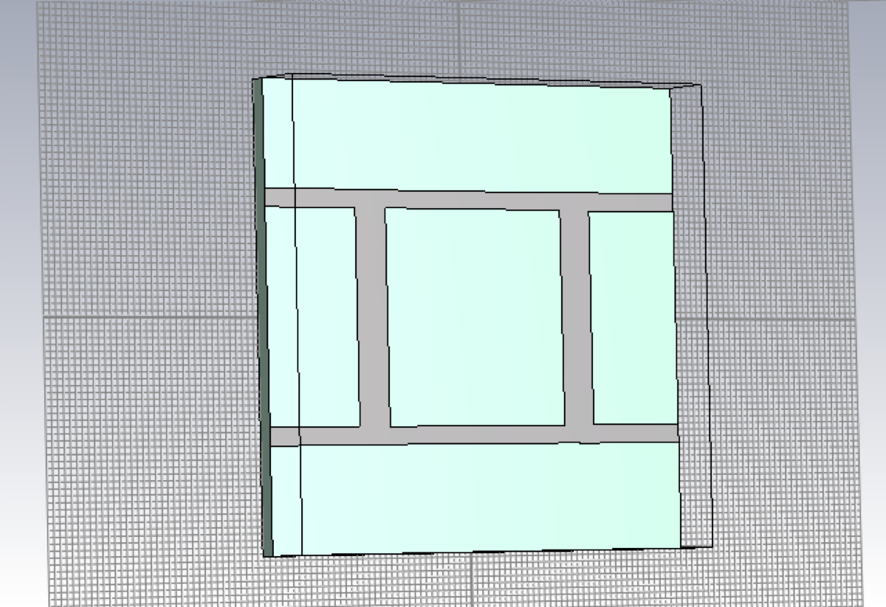
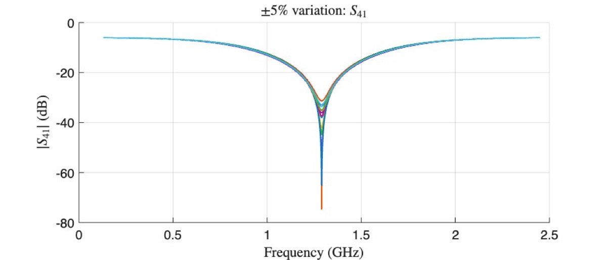

# Assignment 2: unequal-split branch-line coupler in microstrip

[Report (PDF)](report.pdf)

The specification is f0 = 1290 MHz, port impedance Z0 = 80 Ω and k = 4.6, on a substrate with εr = 3.5 and h = 2.9 mm.

1. The analytical design uses even/odd-mode excitation and ABCD matrices. Setting S44 = S41 = 0 gives 1/z02² − 1/z01² = 1, which leads to Z01 = 154.4 Ω, Z02 = 71.0 Ω and the closed-form S-matrix.
2. Hammerstad's formulas give the microstrip dimensions:

   | Line | Z [Ω] | w [mm] | εeff | λ/4 [mm] |
   |---|---|---|---|---|
   | Z01 | 154.42 | 0.42 | 2.45 | 37.1 |
   | Z02 | 71.03 | 3.55 | 2.63 | 35.8 |

3. MATLAB computes the S-parameters from the cascaded ABCD model.
4. A Monte Carlo run with 20 samples varies Z01 and Z02 randomly by ±5 %.
5. A full-wave CST simulation of the microstrip layout checks the design.

