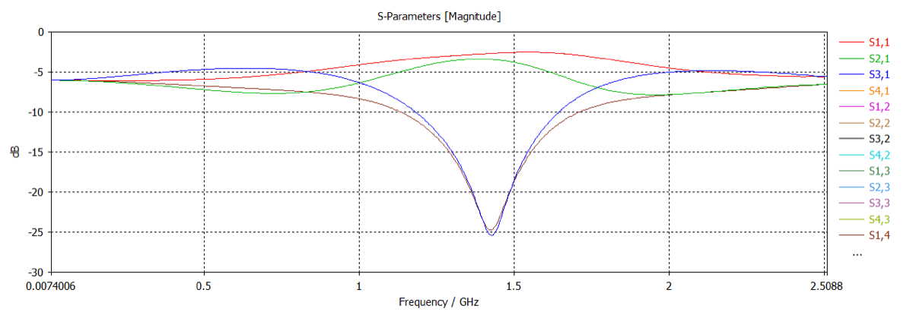

# HW2 — Unequal-Split Branch-Line Coupler in Microstrip

[Report (PDF)](report.pdf)

**Specifications:** f0 = 1290 MHz, port impedance Z0 = 80 Ω, k = 4.6, substrate εr = 3.5, h = 2.9 mm.

1. **Analytical design:** even/odd-mode excitation and ABCD matrices. Imposing S44 = S41 = 0 gives the condition 1/z02² − 1/z01² = 1, which leads to **Z01 = 154.4 Ω** and **Z02 = 71.0 Ω**, plus the closed-form S-matrix.
2. **Microstrip synthesis (Hammerstad):**

   | Line | Z [Ω] | w [mm] | εeff | λ/4 [mm] |
   |---|---|---|---|---|
   | Z01 | 154.42 | 0.42 | 2.45 | 37.1 |
   | Z02 | 71.03 | 3.55 | 2.63 | 35.8 |

3. **MATLAB S-parameters:** computed from the cascaded ABCD model.
4. **Tolerance study:** Monte Carlo with ±5 % random variation of Z01 and Z02 (20 samples).
5. **CST full-wave simulation** of the microstrip layout.

