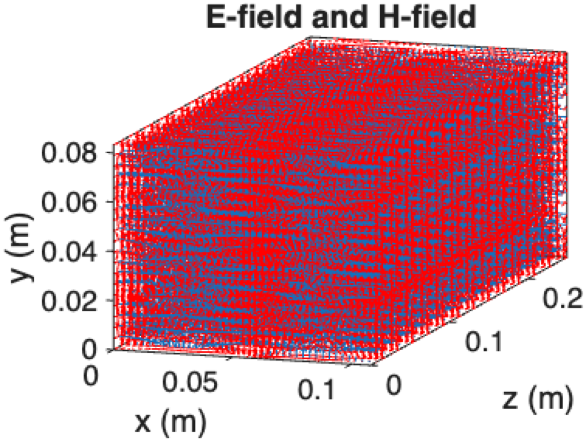
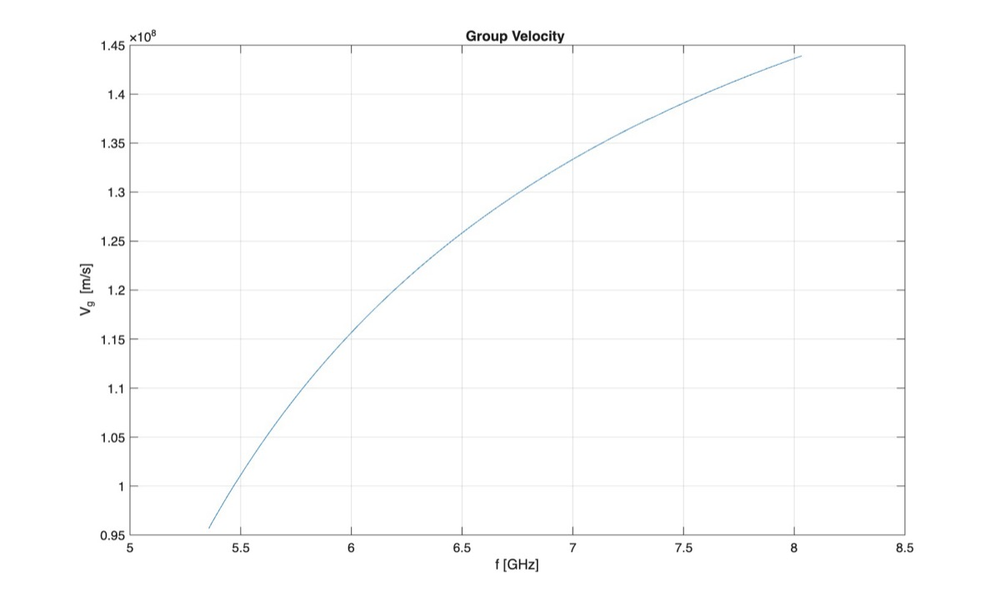
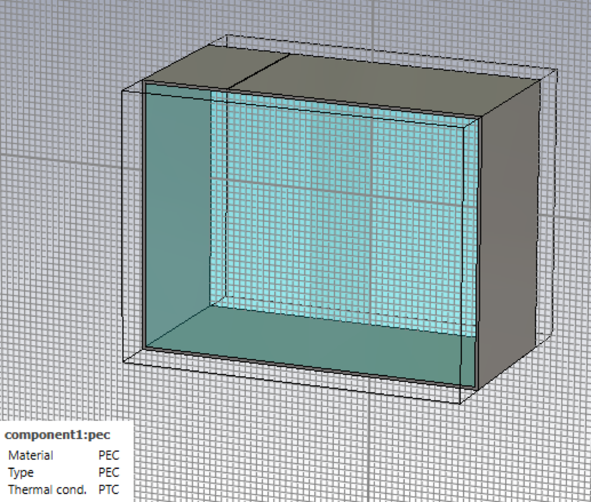

# HW1 — Rectangular Waveguide: TE2,4 Mode Analysis and Modal Filter

[Report (PDF)](report.pdf)

**Structure:** a = 108.0 mm, b = 83.1 mm, εr = 3, PEC walls.

1. **Mode chart:** cutoff frequencies of all TE/TM modes up to TE2,4. TE1,0 cuts off at 0.80 GHz and TE2,4 at 4.46 GHz.
2. **Fields:** closed-form E and H for TE2,4, plotted in MATLAB and simulated in CST, including the surface current density and power flow. fc is 4.463 GHz in MATLAB and 4.459 GHz in CST.
3. **Dispersion (1.2 fc to 1.8 fc):** β, vp, vg, λg and ZTE against frequency.
4. **Intermodal dispersion:** group-delay difference over 90 m, TE1,0 vs TE2,4 and TE1,4 vs TE2,4.
5. **Modal filter:** a PEC wall at x = a/2 and a longitudinal slot at x = a/4. They remove the modes that are incompatible with these boundary conditions and keep TE2,4. The design was checked in CST.

