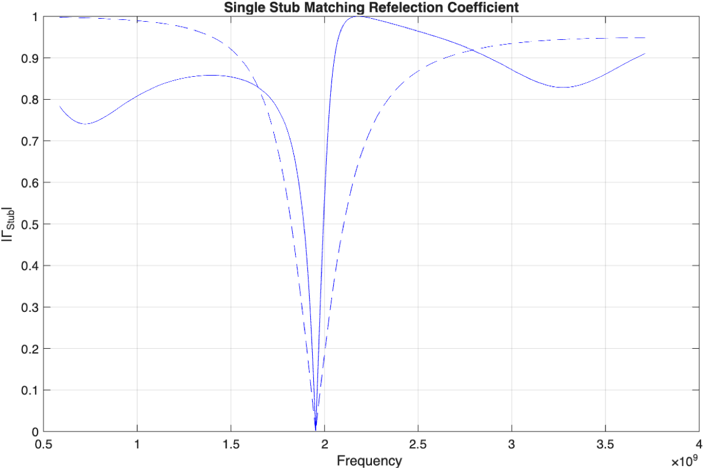
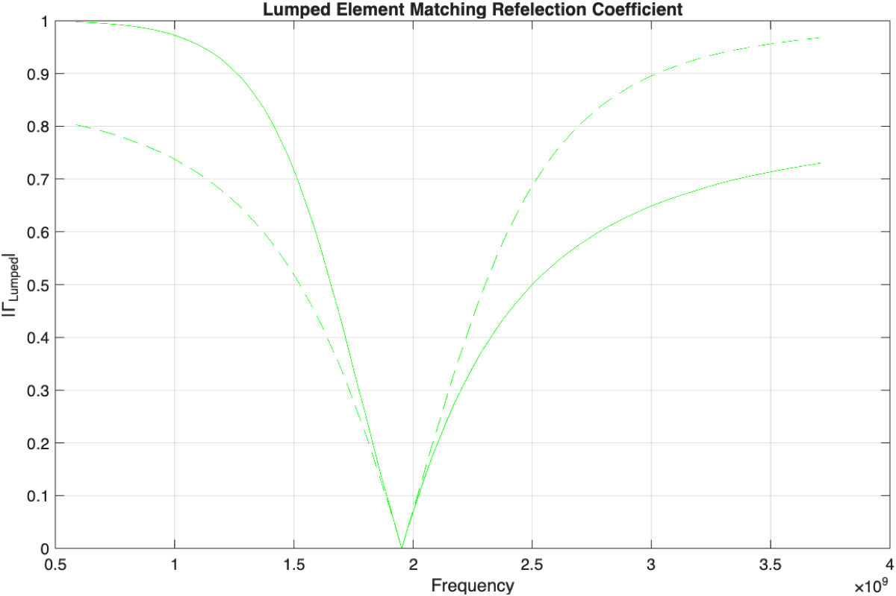
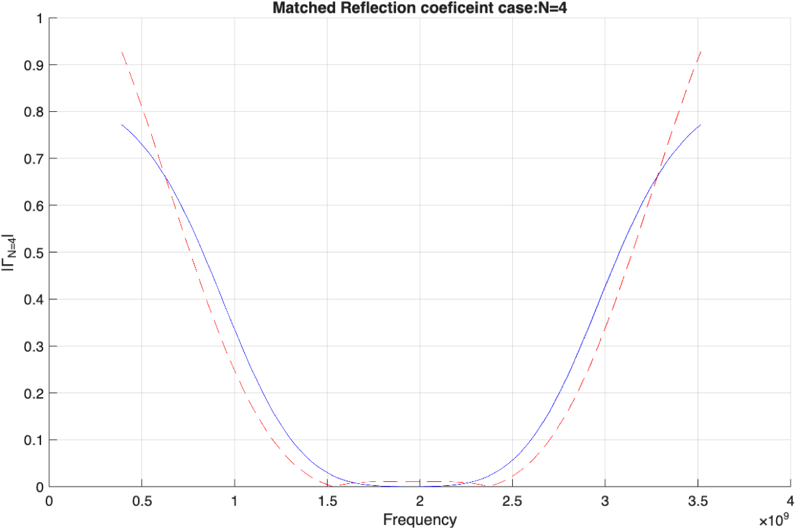

# HW4 — Impedance Matching Networks (533 Ω → 50 Ω at 1.953 GHz)

[Report (PDF)](report.pdf)

| Network | Design | Bandwidth (Γm < 0.025) |
|---|---|---|
| Single shunt stub, solution 1 | d = 31.1 mm, l = 8.0 mm | 11.6 MHz |
| Single shunt stub, solution 2 | d = 45.6 mm, l = 68.8 mm | 4.1 MHz |
| Lumped L-section, solution 1 | C = 0.475 pF, L = 12.7 nH | 32.8 MHz |
| Lumped L-section, solution 2 | C = 0.524 pF, L = 14.0 nH | 32.8 MHz |
| 3-section binomial transformer | 67.2 / 163.2 / 396.5 Ω | see report |
| 4-section binomial transformer | 58.0 / 104.7 / 254.4 / 459.7 Ω | see report |

- Γ(f) for every network comes from cascaded ABCD matrices and is compared with the approximate maximally flat (binomial) formulas.
- The reflection coefficients come out symmetric (Γ0 = ΓN), which confirms the transformer impedances.

