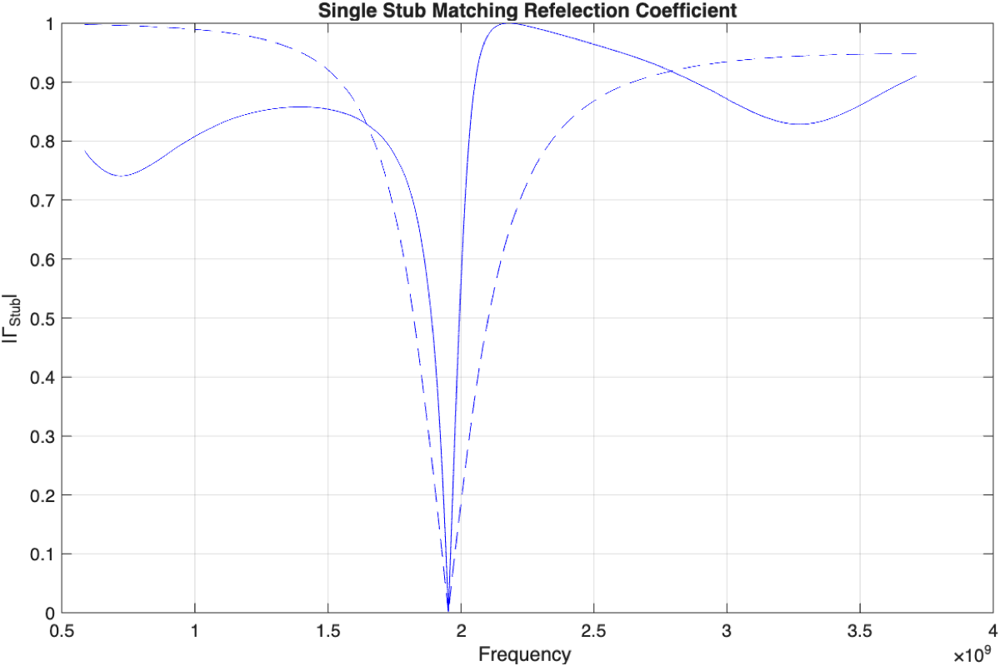
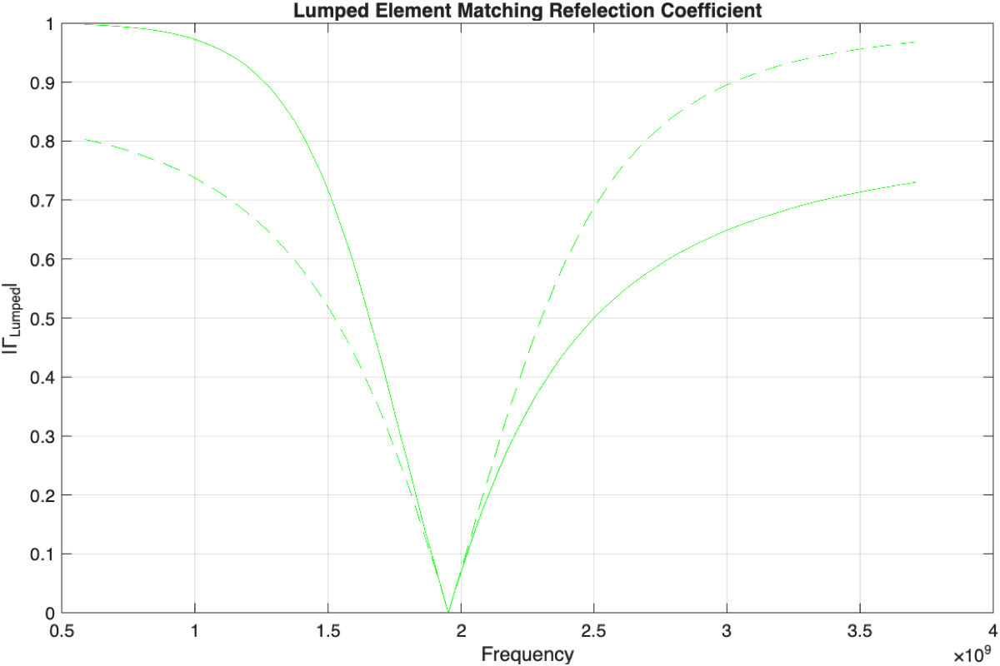
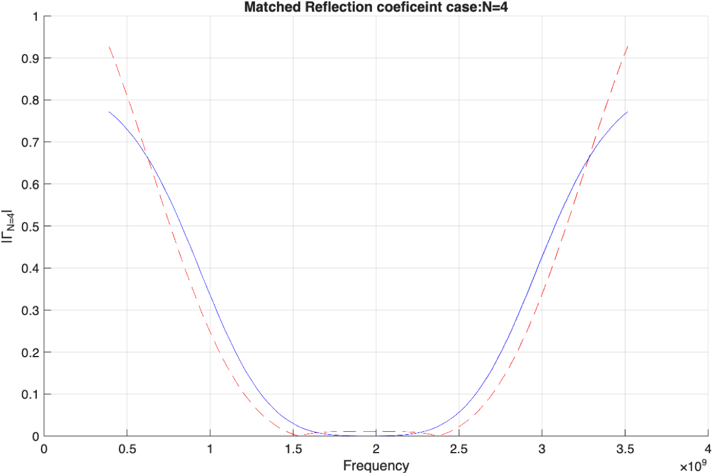

# Assignment 4: matching 533 Ω to 50 Ω at 1.953 GHz

[Report (PDF)](report.pdf)

| Network | Design | Bandwidth at Γm < 0.025 |
|---|---|---|
| Single shunt stub, solution 1 | d = 31.1 mm, l = 8.0 mm | 11.6 MHz |
| Single shunt stub, solution 2 | d = 45.6 mm, l = 68.8 mm | 4.1 MHz |
| Lumped L-section, solution 1 | C = 0.475 pF, L = 12.7 nH | 32.8 MHz |
| Lumped L-section, solution 2 | C = 0.524 pF, L = 14.0 nH | 32.8 MHz |

The binomial transformers use 67.2, 163.2 and 396.5 Ω for three sections, and 58.0, 104.7, 254.4 and 459.7 Ω for four sections. The report gives their bandwidths.

I computed the reflection coefficient of each network from cascaded ABCD matrices and compared it with the approximate maximally flat formulas. The section reflection coefficients are symmetric, Γ0 = ΓN, which confirms the transformer impedances.

