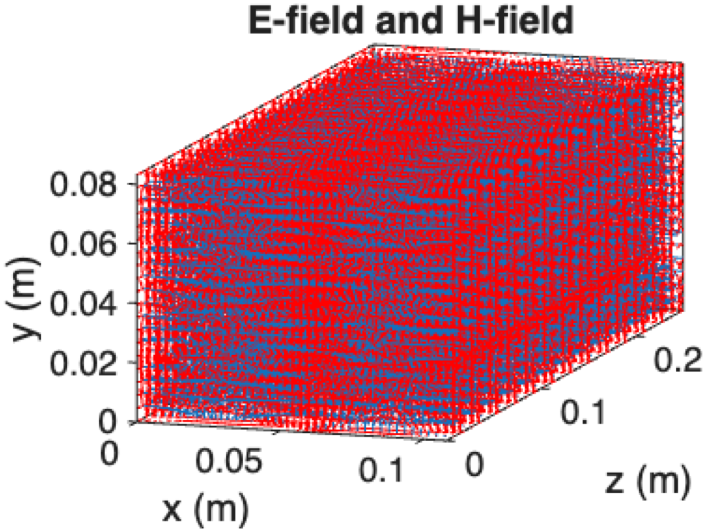
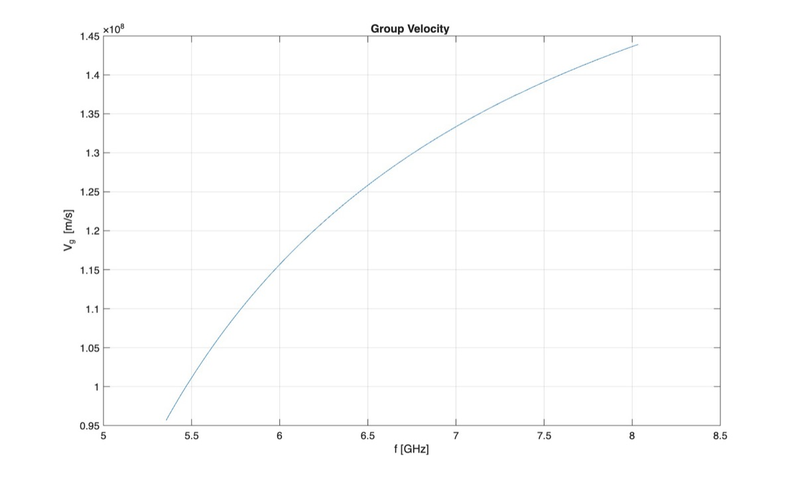
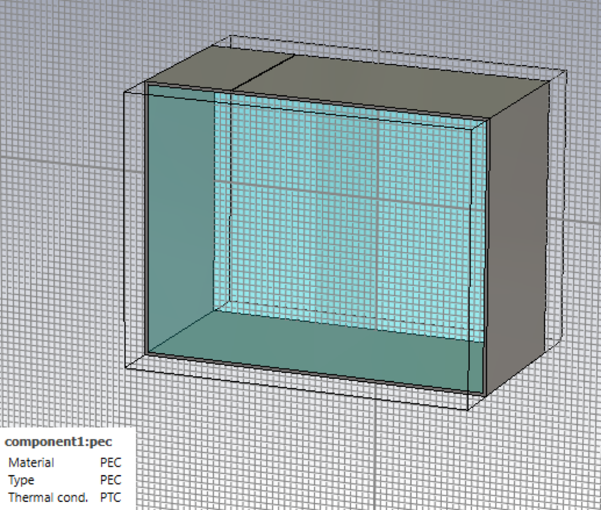

# Assignment 1: TE2,4 mode analysis and modal filter in a rectangular waveguide

[Report (PDF)](report.pdf)

The waveguide has a = 108.0 mm, b = 83.1 mm, εr = 3 and PEC walls.

1. The mode chart lists the cutoff frequency of every TE and TM mode up to TE2,4. TE1,0 cuts off at 0.80 GHz and TE2,4 at 4.46 GHz.
2. I plotted the closed-form E and H fields of TE2,4 in MATLAB and compared them with a CST simulation of the fields, surface current and power flow. The cutoff frequency is 4.463 GHz in MATLAB and 4.459 GHz in CST.
3. I computed β, vp, vg, λg and ZTE from 1.2 fc to 1.8 fc.
4. I computed the intermodal delay over 90 m for TE1,0 against TE2,4 and for TE1,4 against TE2,4.
5. The modal filter uses a PEC wall at x = a/2 and a longitudinal slot at x = a/4. These two boundaries suppress every mode that cannot satisfy them, and TE2,4 still propagates. A CST simulation confirms the design.

